<div align="center">
  <h2>🎮 Gameplay Preview</h2>

  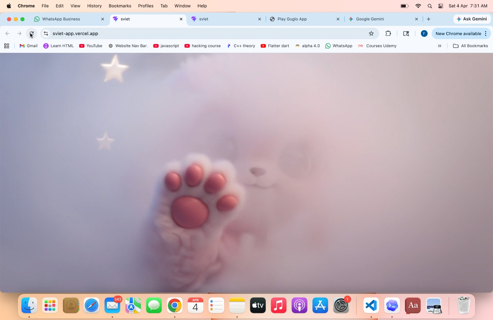
  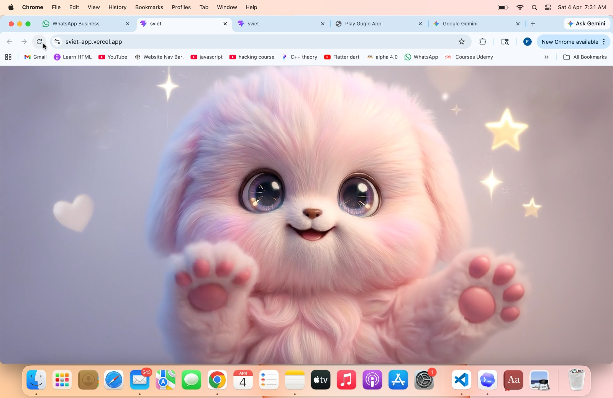
  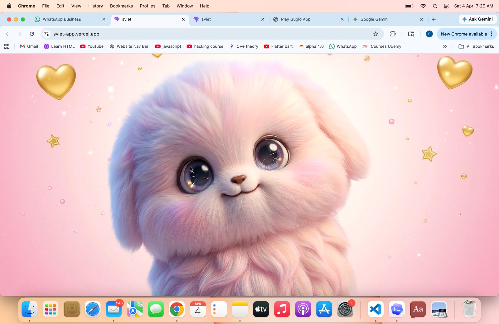

  <br/><br/>

  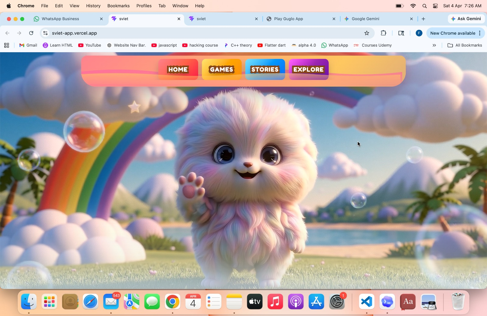
  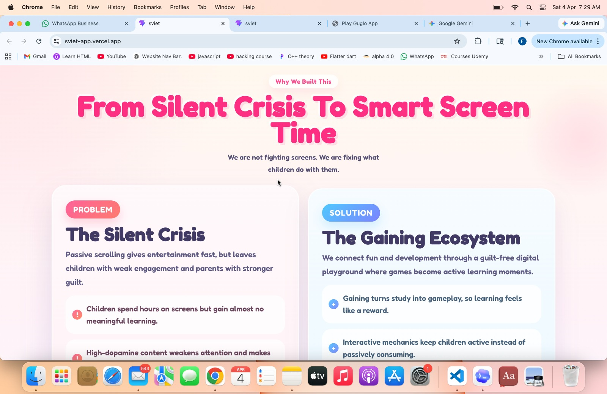
  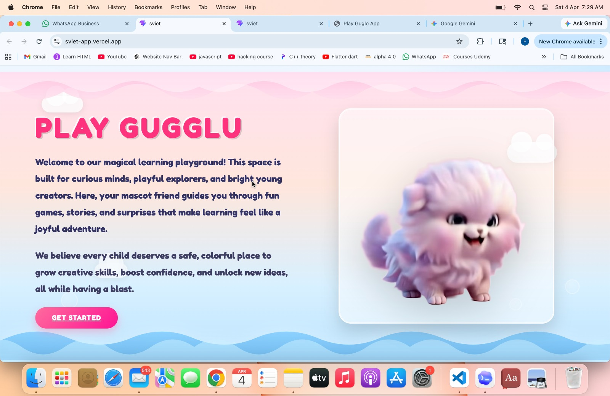

  <br/><br/>

  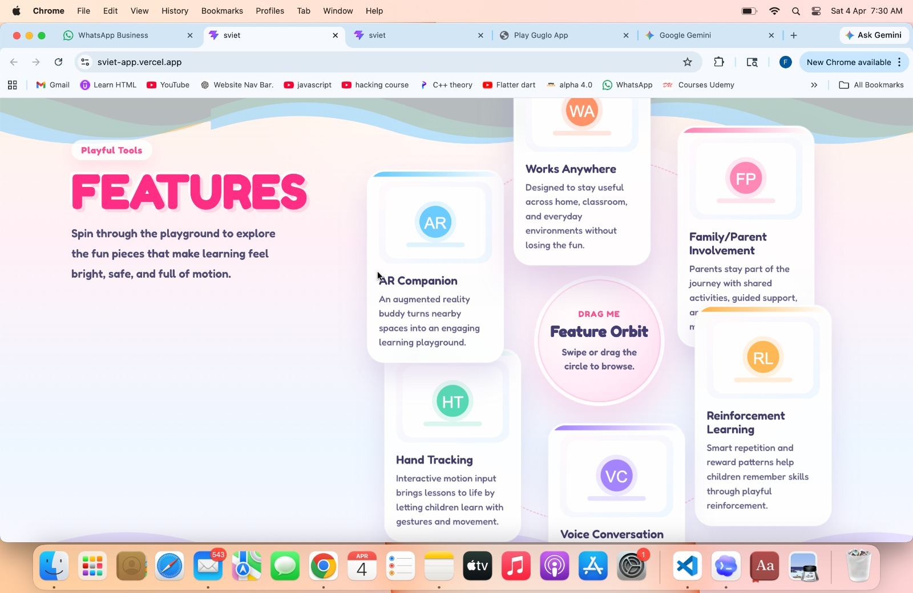
  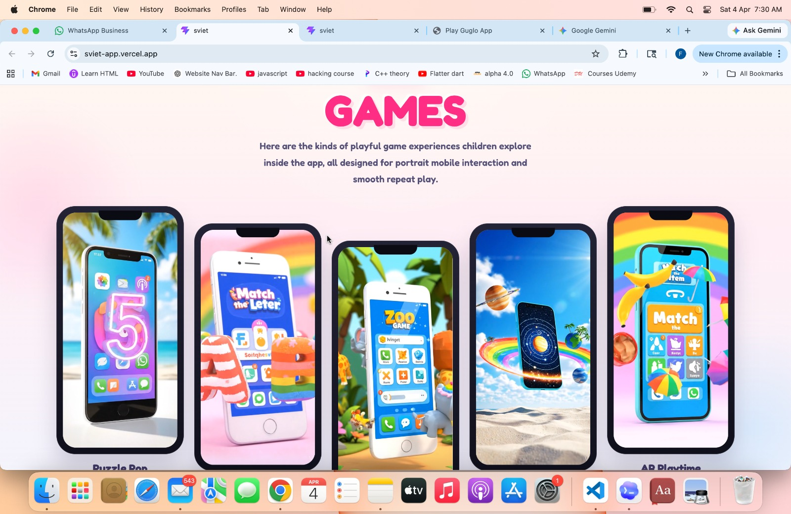
  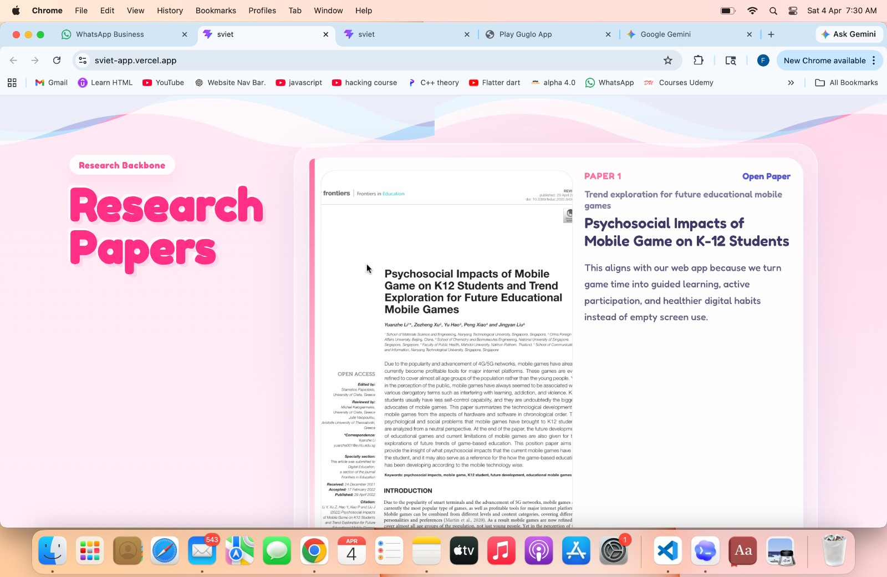

  <br/><br/>

  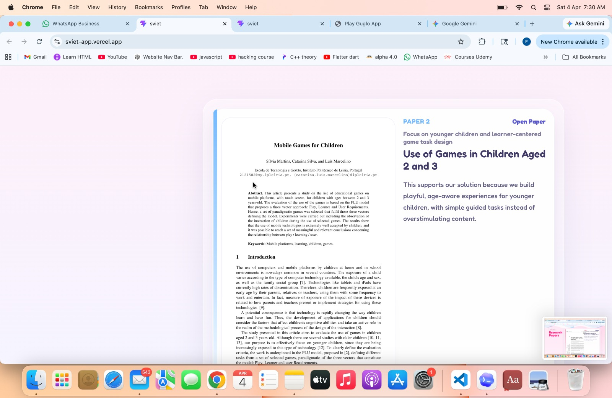
  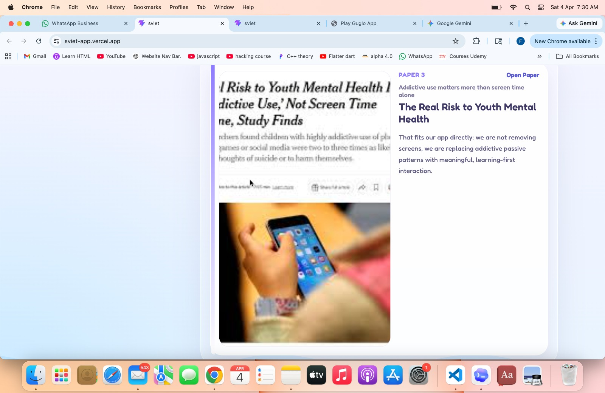
</div>


<div align="center">
  <h1>PlayGugulu</h1>
  <p><strong>Adaptive AI-Powered Learning Platform for Children Ages 3–7</strong></p>

  <p>
    
    
    
    
    
    
  </p>
</div>

---

## Overview

**PlayGugulu** is a next-generation adaptive learning platform that combines interactive games, real-time hand gesture control, and a machine learning pipeline to deliver personalized educational experiences for young children (ages 3–7).

The system profiles each child through a parent onboarding flow, runs XGBoost-powered skill mastery and engagement inference after every play session, and continuously adapts difficulty, activity selection, and content modality to the child's evolving learning state.

> Built with React + TypeScript on the frontend, FastAPI on the backend, and a fully custom ML pipeline — no third-party adaptive learning APIs.

---

## Feature Highlights

| Feature | Details |
|---|---|
| **Adaptive ML Pipeline** | 13 XGBoost classifiers that predict skill mastery and engagement in real-time |
| **Hand Gesture Control** | MediaPipe hand landmark detection — kids grab, drag, and interact without a mouse |
| **AI Mascot Companion** | Animated mascot with TTS, context-aware dialogue, and emotion states |
| **5-Subject Game Hub** | English, Math, Science, Social Science, Creative (Math & English fully implemented) |
| **Parent Insights** | Auto-generated human-readable summaries of every session's performance |
| **Cold-Start Handling** | Age-band priors kick in when there's insufficient gameplay history |
| **Prerequisite Skill DAG** | Skills unlock progressively — phonics gates on letter recognition, etc. |
| **Session Time Caps** | Per-age safe screen time limits enforced by the engine |

---

## Table of Contents

1. [Architecture](#architecture)
2. [AI & ML Models](#ai--ml-models)
3. [Project Structure](#project-structure)
4. [Getting Started](#getting-started)
5. [Environment Variables](#environment-variables)
6. [API Reference](#api-reference)
7. [Games](#games)
8. [Hand Tracking](#hand-tracking)
9. [Tech Stack](#tech-stack)
10. [Contributing](#contributing)

---

## Architecture

```
┌─────────────────────────────────────────────────────────────────┐
│                        React Frontend (Vite)                     │
│  ┌─────────────┐  ┌──────────────┐  ┌──────────────────────┐   │
│  │  Onboarding │  │  Game Routes │  │  MediaPipe Tracking  │   │
│  │   (5 Steps) │  │  (4 games)   │  │  (Hand Gestures)     │   │
│  └──────┬──────┘  └──────┬───────┘  └──────────────────────┘   │
│         │                │                                        │
│  ┌──────▼────────────────▼──────────────────────────────────┐   │
│  │              ChildProfileContext (Global State)           │   │
│  └──────────────────────────┬────────────────────────────────┘   │
└─────────────────────────────┼───────────────────────────────────┘
                              │ HTTP (Proxied via Vite)
┌─────────────────────────────▼───────────────────────────────────┐
│                     FastAPI Backend (Port 8000)                   │
│  POST /api/onboard          POST /api/session/process             │
└──────────────┬──────────────────────────┬───────────────────────┘
               │                          │
┌──────────────▼──────────────────────────▼───────────────────────┐
│                    AdaptiveLearningPipeline                       │
│                                                                   │
│  ┌─────────────────┐     ┌─────────────────────────────────┐    │
│  │  Profile Builder│     │  XGBoost Inference               │    │
│  │  (Onboarding)   │     │  ├─ SkillMasteryClassifier (×11)│    │
│  └─────────────────┘     │  └─ EngagementClassifier (×1)   │    │
│                           └─────────────────────────────────┘    │
│  ┌─────────────────┐     ┌─────────────────────────────────┐    │
│  │  Skill Graph    │     │  Formula Engine                  │    │
│  │  (EMA Updates)  │     │  (Next Activity Decision)        │    │
│  └─────────────────┘     └─────────────────────────────────┘    │
│  ┌─────────────────────────────────────────────────────────┐    │
│  │  Insight Generator (Parent Summary + Session Summary)   │    │
│  └─────────────────────────────────────────────────────────┘    │
└─────────────────────────────────────────────────────────────────┘
```

---

## AI & ML Models

The ML pipeline lives in [`ML_models/`](ML_models/) and is the core of what makes PlayGugulu adaptive.

### Model 1 — Skill Mastery Classifiers (×11)

**File:** [ML_models/models/skill_mastery.py](ML_models/models/skill_mastery.py)

One independent `XGBClassifier` is trained per skill, each wrapped with `CalibratedClassifierCV` (isotonic regression) to produce well-calibrated probabilities.

**Tracked Skills:**

| Skill | Prerequisites |
|---|---|
| `letter_recognition` | — |
| `phonics` | letter_recognition |
| `counting` | — |
| `number_order` | counting |
| `shape_recognition` | — |
| `color_sorting` | shape_recognition |
| `hand_eye_coordination` | — |
| `attention_retention` | — |
| `memory_recall` | attention_retention |
| `social_response` | — |
| `emotional_regulation` | social_response |

**Input Features per Model:**
- Rolling accuracy windows (last 5, 10, all-time)
- Response time features (mean, variance, slowness ratio)
- Error burst count and session error rate
- Age-normalized features
- Session duration vs allowed limit ratio
- Prior mastery probability (from previous sessions)

**Output:** `{ skill: mastery_probability (0–1), confidence: float }`

**Cold-start behavior:** Falls back to age-band prior probabilities when fewer than 3 gameplay events exist for a skill.

---

### Model 2 — Engagement Classifier (3-class)

**File:** [ML_models/models/engagement_classifier.py](ML_models/models/engagement_classifier.py)

A single `XGBClassifier` (calibrated) predicting one of three states:

| Class | Description |
|---|---|
| `engaged` | Child is focused, responsive, performing well |
| `neutral` | Moderate attention, some variability |
| `fatigued` | Declining accuracy, increasing response times, error bursts |

**Input Features:**
- Accuracy trend slope over session
- Response time variance and drift
- Error burst count
- Session elapsed vs allowed (time pressure)
- Task completion rate
- Consecutive failure count

**Outputs:**
```json
{
  "engagement_state": "engaged",
  "probabilities": { "fatigued": 0.06, "neutral": 0.21, "engaged": 0.73 },
  "fatigue_risk": 0.06,
  "alert_level": "none"
}
```

**Alert levels:** `none` → `soft` (fatigue_risk > 0.60) → `hard_stop` (fatigue_risk > 0.80)

---

### Deterministic Engines

These run on top of the ML outputs using transparent, formula-based logic:

| Engine | File | Role |
|---|---|---|
| **Profile Builder** | [engine/profile_builder.py](ML_models/engine/profile_builder.py) | Converts onboarding form → initial `ChildProfile` with age-band priors |
| **Skill Graph** | [engine/skill_graph.py](ML_models/engine/skill_graph.py) | Updates mastery estimates via EMA; enforces prerequisite DAG gating |
| **Formula Engine** | [engine/formula_engine.py](ML_models/engine/formula_engine.py) | Selects next skill focus, difficulty level, and activity modality |
| **Insight Generator** | [engine/insight_generator.py](ML_models/engine/insight_generator.py) | Generates human-readable parent summaries and session statistics |

---

### AI Companion — Google Gemini

**File:** [src/components/AICompanion.tsx](src/components/AICompanion.tsx)

The animated mascot companion optionally uses the **Google Gemini API** (`@google/genai`) for contextually aware dialogue during onboarding and gameplay. The companion:

- Speaks contextual hints, encouragement, and instructions
- Uses the browser's built-in `speechSynthesis` API for TTS
- Falls back to pre-scripted dialogue when the Gemini API key is not set
- Has 7 visual states: `idle`, `happy`, `thinking`, `speaking`, `jumping`, `liking`, `blinking` — each mapped to a looping video asset

---

### Feature Engineering Pipeline

**File:** [ML_models/data/feature_engineering.py](ML_models/data/feature_engineering.py)

Raw gameplay events arrive as:
```json
{ "skill": "counting", "correct": true, "response_time_ms": 2400, "difficulty": 2 }
```

The feature engineering layer converts these into a fixed-length numerical vector per skill and per session, including windowed statistics, normalized age features, and session-level aggregates — ready for XGBoost inference.

---

### Training

**Scripts:** [ML_models/training/](ML_models/training/)

The models are trained on synthetically generated data (see [data/training_schema.py](ML_models/data/training_schema.py)) that simulates realistic age-stratified learning trajectories. Pre-trained `.joblib` artifacts are stored in [ML_models/models/artifacts/](ML_models/models/artifacts/).

To retrain:
```bash
cd ML_models
python -m training.train_skill_mastery
python -m training.train_engagement
```

---

## Project Structure

```
play-guglo/
├── backend/                   # FastAPI application
│   ├── main.py                # API routes + pipeline orchestration
│   └── requirements.txt
│
├── ML_models/                 # Adaptive learning ML pipeline
│   ├── main.py                # AdaptiveLearningPipeline entry point
│   ├── config.py              # Skills, thresholds, age bands, session caps
│   ├── data/
│   │   ├── feature_engineering.py
│   │   └── training_schema.py
│   ├── engine/
│   │   ├── profile_builder.py
│   │   ├── skill_graph.py
│   │   ├── formula_engine.py
│   │   └── insight_generator.py
│   ├── models/
│   │   ├── skill_mastery.py       # 11 XGBClassifiers
│   │   ├── engagement_classifier.py
│   │   └── artifacts/             # Serialized .joblib models
│   ├── training/
│   │   ├── train_skill_mastery.py
│   │   └── train_engagement.py
│   └── schemas/               # JSON schema definitions for all outputs
│
├── src/                       # React + TypeScript frontend
│   ├── App.tsx                # Root router
│   ├── routes/
│   │   ├── OnboardingRoute.tsx
│   │   ├── MathEquationRoute.tsx
│   │   ├── MatchLettersRoute.tsx
│   │   ├── GuessWordRoute.tsx
│   │   └── ScienceSolarRoute.tsx
│   ├── components/
│   │   ├── home/              # HomeScreen, Mascot, GestureCursor
│   │   ├── game/              # MathCube, LetterCube, Balloon, CollisionEngine
│   │   ├── AICompanion.tsx
│   │   └── CameraFeed.tsx
│   ├── hooks/
│   │   ├── useHandTracking.ts # MediaPipe integration
│   │   └── useMascotController.ts
│   ├── store/
│   │   └── ChildProfileContext.tsx
│   └── services/
│       └── api.ts             # Backend API client with fallback handling
│
├── public/                    # Static video/image assets for mascot
├── .env.example
├── vite.config.ts             # Dev proxy: /api → localhost:8000
├── package.json
└── index.html
```

---

## Getting Started

### Prerequisites

- **Node.js** 18+ and npm
- **Python** 3.10+
- A **Gemini API key** (optional — companion works without it)

### 1. Clone & Install Frontend

```bash
git clone https://github.com/your-username/play-guglo.git
cd play-guglo
npm install
```

### 2. Set Up Backend

```bash
cd backend
pip install -r requirements.txt
```

### 3. Set Up ML Models

```bash
cd ML_models
pip install -r requirements.txt

# Train models (only needed if artifacts/ is empty)
python -m training.train_skill_mastery
python -m training.train_engagement
```

### 4. Configure Environment

```bash
cp .env.example .env.local
# Edit .env.local and set your GEMINI_API_KEY
```

### 5. Run

Open two terminals:

```bash
# Terminal 1 — Backend
cd backend
uvicorn main:app --reload --port 8000

# Terminal 2 — Frontend
npm run dev
```

Visit [http://localhost:3000](http://localhost:3000).

---

## Environment Variables

| Variable | Required | Description |
|---|---|---|
| `GEMINI_API_KEY` | Optional | Google Gemini API key for enhanced AI companion dialogue |
| `APP_URL` | Optional | Public app URL for use in production builds |

Create a `.env.local` file in the project root (see [.env.example](.env.example)).

---

## API Reference

### `POST /api/onboard`

Creates an initial child profile from parent onboarding data.

**Request:**
```json
{
  "parent_email": "parent@example.com",
  "child_name": "Emma",
  "child_age": 5,
  "interests": ["music", "stories", "puzzles"],
  "goals": ["phonics", "counting"],
  "language": "en",
  "sensitivities": [],
  "allowed_session_minutes": 15
}
```

**Response:**
```json
{
  "success": true,
  "child_profile": {
    "child_id": "uuid",
    "name": "Emma",
    "age_band": "preschool",
    "skill_mastery_probs": {
      "phonics": 0.25,
      "counting": 0.30,
      "letter_recognition": 0.35
    },
    "unlocked_skills": ["letter_recognition", "counting", "shape_recognition"],
    "recommended_first_session_plan": {
      "skill_focus": "letter_recognition",
      "difficulty": 2,
      "modality": "visual"
    },
    "flags": { "new_user": true, "cold_start": true }
  }
}
```

---

### `POST /api/session/process`

Runs the full ML inference pipeline after a gameplay session.

**Request:**
```json
{
  "session_events": [
    { "skill": "counting", "correct": true, "response_time_ms": 2400, "difficulty": 2 },
    { "skill": "counting", "correct": false, "response_time_ms": 5100, "difficulty": 2 }
  ],
  "child_profile": { "...existing ChildProfile..." },
  "session_meta": {
    "session_id": "uuid",
    "elapsed_seconds": 720,
    "allowed_minutes": 15
  }
}
```

**Response:**
```json
{
  "success": true,
  "pipeline_meta": { "child_id": "...", "inference_ms": 42 },
  "skill_graph": {
    "skill_nodes": [
      { "skill": "counting", "mastery_prob": 0.61, "difficulty": 2 }
    ]
  },
  "engagement_state": {
    "engagement_state": "engaged",
    "fatigue_risk": 0.08,
    "alert_level": "none"
  },
  "next_activity": {
    "next_skill_focus": "number_order",
    "difficulty": 2,
    "modality": "visual",
    "reason": "counting mastery crossed 0.60 threshold — unlocking number_order"
  },
  "parent_summary": {
    "human_summary": "Emma had a great session! She's making strong progress in counting...",
    "strengths": ["counting", "shape_recognition"],
    "areas_to_improve": ["phonics"]
  },
  "session_summary": {
    "duration_minutes": 12,
    "tasks_completed": 8,
    "overall_accuracy": 0.75
  }
}
```

---

### `GET /api/health`

Returns backend and ML model status.

```json
{
  "status": "ok",
  "models_trained": true
}
```

---

## Games

### Match Letters
Children match uppercase balloon letters to their lowercase counterparts by dragging them together. Covers `letter_recognition` and `phonics`.

### Guess the Word
An image is shown and children drag letter tiles to spell the word. Covers `letter_recognition`, `phonics`, and `memory_recall`.

### Build Equations
Children drag number cubes and operator symbols to build and solve math equations. Covers `counting` and `number_order`.

### Solar System Explorer
A camera-based AR-style solar system where children explore planets using hand gestures. Covers `shape_recognition` and general curiosity/engagement.

---

## Hand Tracking

**File:** [src/hooks/useHandTracking.ts](src/hooks/useHandTracking.ts)

PlayGugulu uses **MediaPipe Tasks Vision** for real-time hand landmark detection. No mouse required — children interact by physically reaching toward the screen.

**How it works:**
1. Webcam feed is streamed via [CameraFeed.tsx](src/components/CameraFeed.tsx)
2. MediaPipe detects 21 hand landmarks at 30fps
3. The index fingertip position is mapped to screen coordinates
4. **Pinch gesture** (thumb + index finger close) triggers grab/release
5. A smoothed physics cursor ([GestureCursor.tsx](src/components/home/GestureCursor.tsx)) renders the hand position

**Tuning parameters** (in `useHandTracking.ts`):
- Pinch detection threshold
- Grab/release hysteresis gap
- Cursor smoothing factor

---

## Tech Stack

| Layer | Technology |
|---|---|
| **Frontend Framework** | React 19 + TypeScript 5.8 |
| **Build Tool** | Vite 6 |
| **Styling** | Tailwind CSS 4 |
| **Routing** | React Router DOM 7 |
| **Animations** | Motion (Framer Motion) |
| **Hand Tracking** | MediaPipe Tasks Vision 0.10 |
| **AI Companion** | Google Gemini API (`@google/genai`) |
| **Backend Framework** | FastAPI 0.110 |
| **Backend Server** | Uvicorn (ASGI) |
| **Data Validation** | Pydantic v2 |
| **ML Framework** | XGBoost 2.0 |
| **ML Calibration** | scikit-learn `CalibratedClassifierCV` |
| **Data Processing** | pandas, numpy |
| **Model Serialization** | joblib |
| **State Management** | React Context API |
| **Icons** | lucide-react |
| **Effects** | canvas-confetti |

---

## ML Configuration Reference

All ML thresholds and constants live in [ML_models/config.py](ML_models/config.py):

| Constant | Value | Meaning |
|---|---|---|
| `MASTERY_LOW_THRESHOLD` | 0.40 | Below this → skill needs work |
| `MASTERY_HIGH_THRESHOLD` | 0.70 | Above this → skill is mastered |
| `PREREQUISITE_GATE` | 0.45 | Minimum mastery to unlock dependent skills |
| `FATIGUE_SOFT_ALERT` | 0.60 | Warn parent, slow down |
| `FATIGUE_HARD_STOP` | 0.80 | End session immediately |

**Session time caps by age band:**

| Age Band | Ages | Max Session |
|---|---|---|
| `toddler` | 2–4 | 10 min |
| `preschool` | 4–6 | 15 min |
| `early_primary` | 6–8 | 20 min |
| `primary` | 8–11 | 25 min |

---

## Contributing

1. Fork the repository
2. Create a feature branch: `git checkout -b feature/your-feature`
3. Make changes and ensure the backend + frontend both run cleanly
4. Submit a pull request

For ML model changes, include training metrics in your PR description.

---

<div align="center">
  <p>Built for curious kids and the parents who believe in them.</p>
</div>
